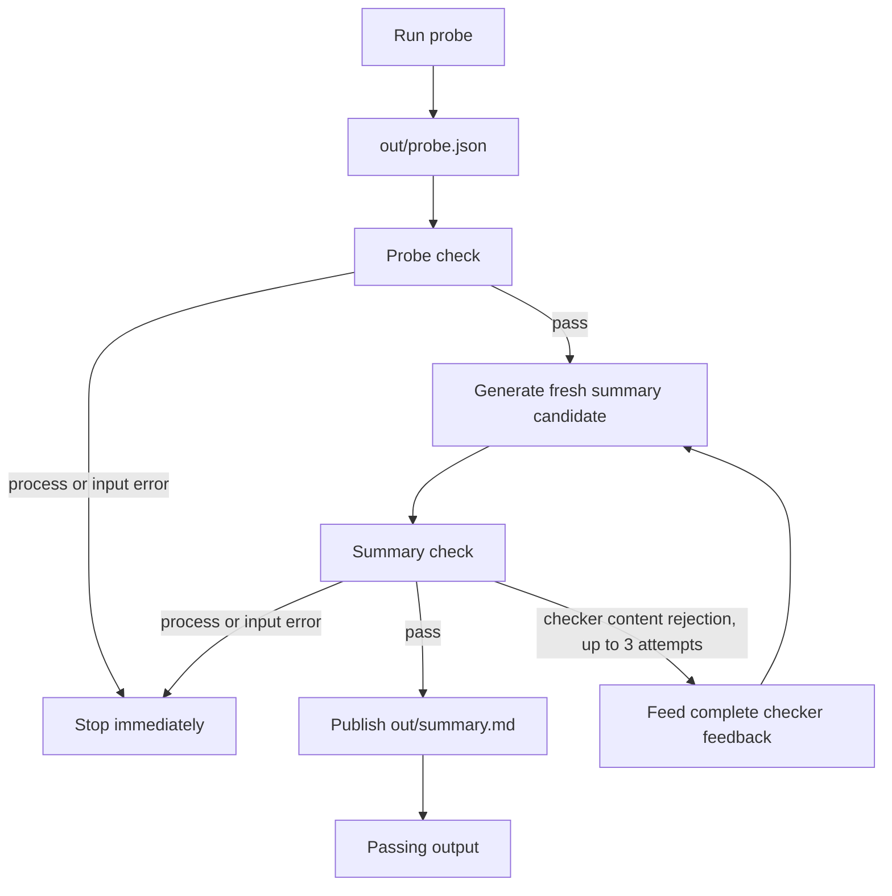

# Agentic Workflow Course Project

## Compulsory 2: automation course overview

The walking skeleton covers exactly three Fagskolen Innlandet automation
courses. A single command collects filtered source sections, snapshots that
run's input, asks Codex to extract structured records, checks every fact
against same-course source quotations, then publishes JSON and a Norwegian
comparison locally:

```sh
./harness/run_courses.sh --offline
```

### Verified Compulsory 2 checkpoint -- 28 October 2026

The patched repository passed all 65 tests in ordinary WSL. The actual course
workflow then completed with exit code 0 on extraction attempt 1 and published
both outputs. Its evidence directory is
`out/training/run-20261028T165059Z-SOo49E`. The comparison retains the two exact
course starts and deadlines, study-fee/materials distinction, admission
alternatives, and the third course's unknown dates/fee and planned autumn 2027
start. This is one successful real-model smoke test, not a general accuracy
estimate. Earlier rejected runs remain recorded in the task notes.

Run the full regression suite from ordinary WSL:

```sh
.venv/bin/python -m unittest discover -s tests
```

The current suite has 28 course-specific tests and 37 retained W43 tests.

`--offline` uses the checked-in source fixture for collection; the extraction
stage still calls Codex. Without `--offline`, the existing collector fetches
only the approved pages and `robots.txt` with its existing robots, timeout,
pacing, response-size, and filtering controls. Preview without side effects:

```sh
./harness/run_courses.sh --offline --dry-run
./harness/run_courses.sh --dry-run
```

Each execution retains its input snapshot, candidate files, model event logs,
and checker feedback in a unique ignored `out/training/run-*` directory. A
candidate must pass `eval/check_courses.py` before either
`out/training/courses.json` or `out/training/comparison.md` is published. Only
candidate validation rejection is retried, at most twice after the first
attempt; model, timeout, missing-output, and checker infrastructure failures
stop immediately. Offline means source collection uses the fixture; it does
not mean model extraction runs offline.

The original read-only source snapshot is retained unchanged. An additional
`agent-source-view.json` annotates those same sections with their zero-based
indices. Each retry receives the preceding rejected JSON and complete checker
feedback, so it can repair that candidate without starting again from an
unrelated response. The prompt requires source-language text copied from its
evidence, complete missing-field flags, and preservation of alternative
admission routes and qualifications. The checker still decides whether to
accept the result; these prompt changes do not guarantee model success.

The checked-in schema is `harness/course_records.schema.json`. Each extracted
fact includes a verbatim quotation and zero-based source section index, so
repeated section labels remain distinct. Missing and uncertain values stay
explicitly missing; a deadline alone does not establish that applications are
open. The checker validates structure, source metadata, quotation membership,
dates, and fee amounts. These mechanical checks cannot prove that every
prerequisite or qualification was interpreted completely. The report records
source retrieval times and links to each source.

The source collector gathers filtered course sections from the three approved
pages. It stores labelled source evidence in
`out/training/course-sources.json`. Source text is untrusted data throughout
the extraction and comparison workflow.

Run a live collection (refreshes the output, not the offline fixture):

```sh
python3 harness/course_sources.py
```

Use the checked-in course-only source fixture without network access:

```sh
python3 harness/course_sources.py --offline
```

The first successful filtered live capture creates the fixture under
`fixtures/courses/`; later live refreshes update only the output.

## Task planning skill

Use the repository-local skill explicitly with a three-digit task number, for
example `$task-plan 005`, to get a read-only plan for the matching task file.
The skill reports the goal, current implementation state, proposed steps,
affected files, and exact acceptance commands marked `NOT RUN`. It does not
make changes or run those commands.

The MET Norway probe reads `fixtures/met_hamar.json` when run with `--offline`.
This mode does not make a network request or change the fixture. Normal runs
reuse the HTTP cache at `out/met_hamar_cache.json` until its `Expires` time,
then refresh it from the MET Norway Locationforecast API. The generated probe
output remains at `out/probe.json`.

Live requests use Hamar coordinates (`60.7945`, `11.0679`) and advertise gzip
and HTTP deflate compression; uncompressed responses are also accepted.

MET Norway forecast data is provided under the [CC BY 4.0](https://creativecommons.org/licenses/by/4.0/)
license. The live API terms are documented at
https://api.met.no/doc/TermsOfService.

## Workflow preview

Use the Bash runner to preview the workflow without executing any stages:

```sh
./harness/run.sh --dry-run
./harness/run.sh --offline --dry-run
```

The offline preview uses `fixtures/met_hamar.json` as the probe input. The
normal preview shows the HTTP cache or MET API as the source. Both previews
show the probe and checker stages, plus summary generation and validation with
up to three attempts. Preview mode does not execute commands or create files.
The runner resolves the repository root from its own path, so these commands
also work outside the repository directory.

## Offline run

Prerequisites are Python 3, Bash, GNU `timeout`, and the Codex CLI configured
to use the `gpt-6-luna` model service. An offline run uses the saved fixture
for the probe, but summary generation still calls the configured model
service. To execute the checked workflow:

```sh
python3 harness/probe.py --offline && python3 eval/check_probe.py
./harness/run.sh --offline --dry-run
./harness/run.sh --offline
```

The runner executes the probe, then its checker, before making any model call.
If either fails, it stops. Summary generation uses the checked-in prompt and
the verified headless Codex settings below. A unique `out/workflow-*` folder
keeps each run's candidates and logs; evidence from previous runs is retained.
Each generated candidate is checked against `out/probe.json`. Only a passing
candidate is copied to `out/summary.md`. A content rejection (checker exit
code 1) is sent back as feedback for the next attempt, for up to three
attempts. Model failures, timeouts, and checker file/input errors stop
immediately. Offline mode applies to the probe input, not model generation.



Probe or checker process/input errors stop the workflow immediately. Only a
summary content rejection enters the bounded feedback loop; each retry uses a
fresh candidate and the previous checker's complete feedback.

The equivalent one-off generation command (the runner supplies a unique
candidate path and attempt-specific logs) uses:

```sh
timeout --kill-after=5s 90s codex exec \
  --strict-config --ephemeral --json \
  -m gpt-6-luna \
  -c 'model_reasoning_effort="low"' \
  -c 'default_permissions="course_summary"' \
  -c 'approval_policy="never"' \
  -c 'web_search="disabled"' \
  -c 'agents.enabled=false' \
  -o out/summary.md - \
  < harness/prompts/summarise.md \
  > out/summary.events.jsonl \
  2> out/summary.stderr.log &&
python3 eval/check_summary.py
```

The CLI writes the generated paragraph using `-o`, while
`course_summary` restricts the commands executed by the agent. The runner
checks the attempt candidate and publishes it only after validation succeeds.

Here, “offline” describes the saved weather input: `--offline` reads
`fixtures/met_hamar.json` without a live MET request. Generating a summary
still calls the configured model service. The summary permission profile
includes a read permission for the versioned NVM installation; that path
must match the Codex runtime installation used by the reader.

Prior headless runs used the `course_summary` permission profile and passed
the summary checker. The saved input has 83 entries from 3–13 October 2026,
with temperatures ranging from -0.3 °C to 16.6 °C.

On 2026-10-28, the deterministic suite passed all 28 tests. The actual
`./harness/run.sh --offline` execution completed with workflow exit code 0
and passed summary attempt 1. The published `out/summary.md` independently
passed its checker with exit code 0 and included the correct minimum
(-0.3 °C) and maximum (16.6 °C). Evidence is in
`out/workflow-20261028T065410Z-mTeyor`. No live MET request was made. Retry
and failure paths were exercised with stubs, not by this successful model run.

The summary checker verifies a 20–80 word count, a case-insensitive Hamar
mention, inclusion of the input minimum and maximum with °C, and that every
temperature stated with °C occurs in the probe input. It does not check the
summary’s historical/current framing, whether other claims are supported, or
that a generated summary was produced offline.

## W43 custom MCP forecast demo

Install the pinned optional MCP dependency from `requirements-mcp.txt` in
`.venv`, then start the demo from the repository root:

```sh
codex -c 'mcp_servers.met.enabled=true'
```

The `forecast(hours=24)` tool reads the saved fixture only and returns up to 24
historical forecast entries beginning at its first timestamp. These entries
are not current weather or observations; the parameter limits the number of
entries and does not guarantee a duration in hours. MET Norway data is provided
under [CC BY 4.0](https://creativecommons.org/licenses/by/4.0/).

The MCP demo selects up to 24 usable entries. The existing workflow summary
uses all probe items. Run the complete test suite from a normal WSL shell with:

```sh
.venv/bin/python -m unittest discover -s tests
```

## GitHub Actions checks

The `checks` workflow runs on pull requests and pushes to `main`. Its single
Ubuntu 24.04 job installs the MCP requirements in `.venv`, confirms that the
MCP SDK imports, and runs these checks:

- `bash -n harness/run.sh`
- `./harness/run.sh --offline --dry-run`
- `./harness/run.sh --dry-run`
- `.venv/bin/python harness/probe.py --offline`
- `.venv/bin/python eval/check_probe.py`
- `.venv/bin/python -m unittest discover -s tests`
- `git diff --check`
- `git diff --exit-code -- fixtures/`

Reproduce the CI checks locally from the repository root with:

```sh
python -m venv .venv
.venv/bin/python -m pip install -r requirements-mcp.txt
.venv/bin/python -c 'import mcp'
bash -n harness/run.sh
./harness/run.sh --offline --dry-run
./harness/run.sh --dry-run
.venv/bin/python harness/probe.py --offline
.venv/bin/python eval/check_probe.py
.venv/bin/python -m unittest discover -s tests
git diff --check
git diff --exit-code -- fixtures/
```

Here, offline means the probe uses the saved fixture and test inputs are
mocked. Installing dependencies still downloads packages.
