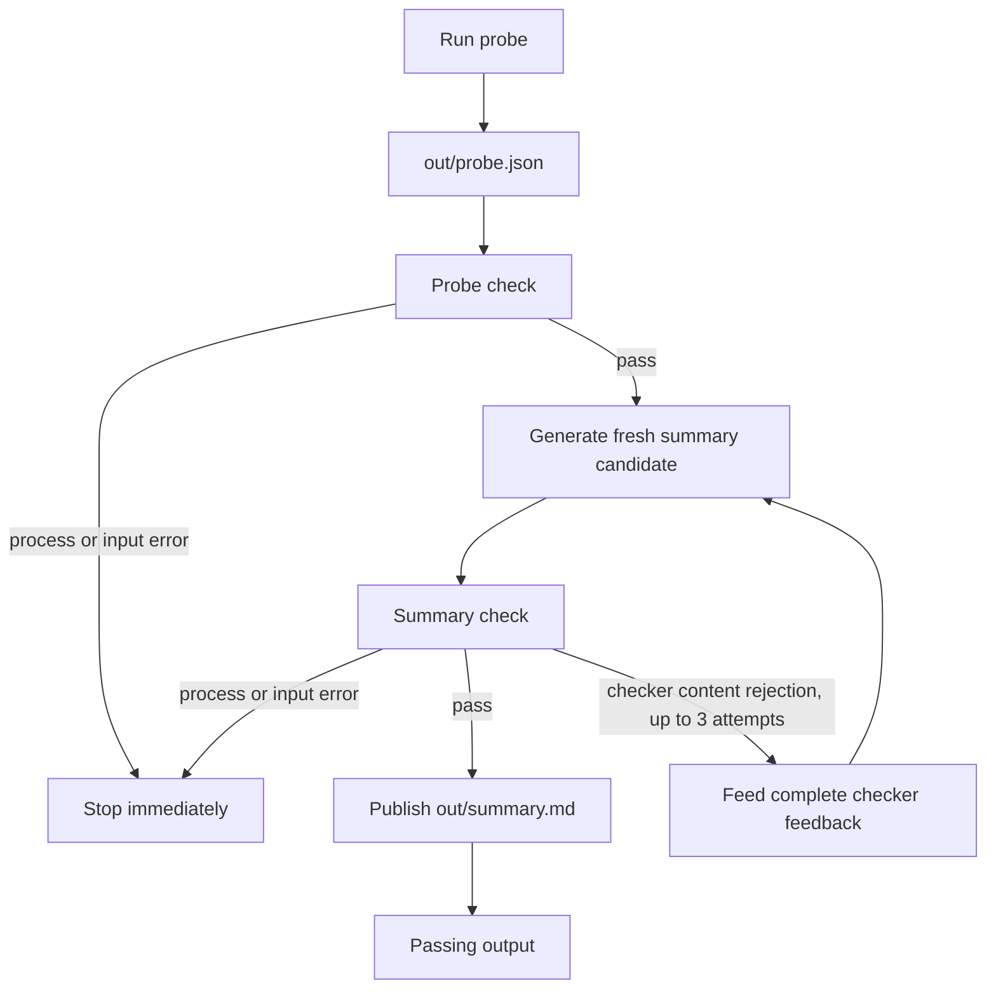

# Agentic Workflow Course Project

## Compulsory 2: automation course overview

The walking skeleton covers exactly three Fagskolen Innlandet automation
courses. The normal runner collects filtered source sections, snapshots that
run's input, calls the Responses API through the budgeted course controller,
checks every fact against same-course source quotations, then publishes JSON
and a Norwegian comparison locally. Actual runs require a runtime
`OPENAI_API_KEY` and three explicit positive integer limits. The values below
are example caller choices, not project defaults:

```sh
export OPENAI_API_KEY  # export a value already supplied by your environment
./harness/run_courses.sh --offline --run-token-limit 32000 --max-output-tokens 12000 --max-model-calls 3
```

### Verified Compulsory 2 checkpoint -- 28 October 2026

The patched repository passed all 65 tests in ordinary WSL. The actual course
workflow then completed with exit code 0 on extraction attempt 1 and published
both outputs. Its evidence directory is
`out/training/run-20261028T165059Z-SOo49E`. The comparison retains the two exact
course starts and deadlines, study-fee/materials distinction, admission
alternatives, and the third course's unknown dates/fee and planned autumn 2027
start. This is one successful real-model smoke test, not a general accuracy
estimate. Earlier rejected runs remain recorded in the task notes.

Run the full regression suite from ordinary WSL:

```sh
.venv/bin/python -m unittest discover -s tests
```

The course runner and the unrelated W43 workflow remain separate command
paths.

`--offline` uses the checked-in source fixture for collection; extraction
still calls the model service. Without `--offline`, the existing collector fetches
only the approved pages and `robots.txt` with its existing robots, timeout,
pacing, response-size, and filtering controls. Preview without side effects:

```sh
./harness/run_courses.sh --offline --dry-run
./harness/run_courses.sh --dry-run
```

Each execution retains its input snapshot, fresh candidates, safe request and
budget provenance, exact checker feedback, and rendered evidence in a unique
ignored `out/training/run-*` directory. One caller-owned token ledger covers
all attempts in the run. A candidate must pass `eval/check_courses.py` before
either `out/training/courses.json` or `out/training/comparison.md` is
published. Only a completed candidate rejection is retried, at most three
attempts total; uncertain usage, budget, provider, checker, and renderer
failures stop the run. The two published files are replaced separately, so
publication is not an atomic two-file transaction. Offline means source
collection uses the fixture; model extraction still uses the service.

CLI exit codes are: `2` invalid arguments, `3` missing runtime key, `4`
collection or source rejection, `5` three rejected candidates, `6` exhausted
token or call allowance, `7` provider/protocol abort, and `8` checker,
renderer, evidence, or publication failure. Dry-run and successful runs exit
`0`; interrupted extraction/checking/rendering exits `130`.

For non-null dates, the checker also verifies the requested role from the
cited source section. It reads explicit labelled field/value dates and maps
dates in the fixture's flattened table using the order of its date headers.
Date-only quotations are accepted when their cited section gives one
unambiguous role/value; unsupported and ambiguous role assignments are
rejected with a course and field message. This is a structural check of
explicit labels and headers, not a general semantic review of source meaning.
The date-bearing quotation and role context must belong to the same evidence
item. All date-bearing citations must agree; a clear citation cannot mask an
ambiguous one. Labelled values must be explicit date cells, rather than dates
found later in unrelated prose. Every row of the supported flattened table is
examined: differing values without an offering selector are ambiguous, and
unrecognised rows are rejected instead of silently selecting the first row.

The original read-only source snapshot is retained unchanged. Each retry
receives the preceding rejected JSON and complete checker feedback through
the existing repair contract, so it can repair that candidate without
starting again from an unrelated response. The model request contains only
approved source data, the existing extraction instructions and schema, and
the production checker's repair feedback. The checker still decides whether
to accept the result; the prompt does not guarantee model success.

The checked-in schema is `harness/course_records.schema.json`. Each extracted
fact includes a verbatim quotation and zero-based source section index, so
repeated section labels remain distinct. Missing and uncertain values stay
explicitly missing; a deadline alone does not establish that applications are
open. The checker validates structure, source metadata, quotation membership,
dates, and fee amounts. These mechanical checks cannot prove that every
prerequisite or qualification was interpreted completely. The report records
source retrieval times and links to each source.

The source collector gathers filtered course sections from the three approved
pages. It stores labelled source evidence in
`out/training/course-sources.json`. Source text is untrusted data throughout
the extraction and comparison workflow.

### Task 014 Phase C1: budgeted normal course controller

`harness/course_workflow.py` is the shared extraction/check/retry/render entry
point for normal runs and later evaluation use. Callers supply a fresh case
evidence directory, an injected SDK client, and the existing `TokenLedger`;
the controller does not create or reset a ledger. The normal command creates
one ledger per run. `harness/run_courses.sh` resolves the repository root and
uses `.venv/bin/python` when available, otherwise `python3`.

Before collection or output creation, actual CLI runs validate the explicit
limits and check that `OPENAI_API_KEY` is present without displaying it.
Collector, checker, and renderer subprocesses receive environments with that
key removed. Dry-runs require neither credentials nor an installed SDK and
create no files. `--offline` changes source collection only.

The controller keeps candidates and component evidence under each run's
evidence directory and renders there before normal CLI publication. Actual
evaluation remains disabled; callers that use the shared function directly
must keep the same batch ledger for every case.

The controller blocks that ledger before returning an infrastructure abort
after a context, storage, component, or evidence failure. Interruption also
abandons the shared run. Final failure receipts are best effort when storage
is unavailable; receipt failure cannot authorize another model call. Source
contract rejection remains distinct from a source-snapshot write failure.

The 2026-11-08 provider checkpoint is recorded in
`docs/meetings/2026-11-08-budget-integration.md`. Its independent score of one
recorded pilot candidate was 20/21 value slots, 17/17 required text atoms, and
11/11 prerequisite atoms. This is one pilot result, not overall model
accuracy; qualitative review of the complete evaluation set remains pending.

## Task 013 offline course evaluation

Run the fixed corpus and scoring component controls without model calls or
source collection:

```sh
python3 harness/course_evaluation_cases.py --check
python3 -m unittest discover -s tests -p 'test_course_evaluation.py'
python3 harness/evaluate_courses.py --replay
```

Replay checks all nine fixed source cases and all nine declared candidate
mutations. It generates positive `synthetic_reference` candidates from the
reviewed reference and source quotations, and records mutations as
`mutated_candidate` with parent hashes and mutation IDs. These component
controls are not model accuracy or instruction-resistance performance. The
independent scorer measures 21 value slots and 17 required-text atoms per
accepted candidate; its 11 prerequisite atoms have their own coverage result.
Checker expectations and factual scores are reported separately, and
provenance groups are never combined. A replay passes only when the fixed case
set is complete, the checker/render outcomes match, all seven positive scoring
controls and all nine mutation scoring controls match their per-fact
expectations, and protected-file integrity passes. Candidate qualitative
review remains pending.

Each run writes its source inputs, manifests, candidates, exact checker
feedback, passing render outputs, score details, hash manifest, integrity
results, and a readable summary into a fresh ignored
`out/course-evaluations/run-*` directory. It verifies the frozen source,
reviewed reference, and normal `out/training/` files remain unchanged. There
is no automatic recorded-model import. Run-directory checks reject destinations
outside the repository's `out/` or inside `out/training/`, including symlinked
destinations. Local checker/renderer subprocesses have a 30-second timeout;
timeouts and dispatch failures retain their actual failure kind and no invented
child exit code. Failed runs retain partial results, a final error manifest,
and integrity evidence. Unscored cases remain visible in the planned 147
positive-control and 189 mutation-control value-slot denominators.

`--actual` exits before subprocess dispatch; bounded model evaluation and one
budget across the evaluation batch remain later work. The local component
timeout is not a model token/cost budget.

### Ordinary-WSL Phase B verification — 2026-11-07

The completed ordinary-WSL verification passed the corpus/reference check for
all nine source cases, offline replay, the offline probe and checker, and all
132 repository tests with no skips. Replay matched all 9/9 source preflight
expectations (7/7 accepted cases and 2/2 expected source rejections), all 5/5
checker-rejection and 4/4 checker-pass mutation controls, and all 7/7 positive
and 9/9 mutation scoring controls. All four checker-pass mutations rendered
without failure. Positive controls scored 147/147 value slots, 119/119
required-text atoms, and 77/77 prerequisite atoms; mutations scored 180
correct, 2 missing, and 7 incorrect value slots of 189, with 143/153
required-text atoms and 90/99 prerequisite atoms covered. Replay integrity
passed. All six source, reference, and published-output checksum checks,
whitespace checks, and protected-path diff checks passed.

Verification log: `out/exam/task-013/wsl-phase-b-rW0DJI/verification.log`.
Replay results: `out/course-evaluations/run-20261107T133047.144244Z-3671390d/results.json`.
These offline controls do not measure model accuracy or instruction
resistance. Candidate qualitative review, evaluation-batch budget integration,
and actual model evaluation remain work for a later phase.

Run a live collection (refreshes the output, not the offline fixture):

```sh
python3 harness/course_sources.py
```

Use the checked-in course-only source fixture without network access:

```sh
python3 harness/course_sources.py --offline
```

The first successful filtered live capture creates the fixture under
`fixtures/courses/`; later live refreshes update only the output.

## Task planning skill

Use the repository-local skill explicitly with a three-digit task number, for
example `$task-plan 005`, to get a read-only plan for the matching task file.
The skill reports the goal, current implementation state, proposed steps,
affected files, and exact acceptance commands marked `NOT RUN`. It does not
make changes or run those commands.

The MET Norway probe reads `fixtures/met_hamar.json` when run with `--offline`.
This mode does not make a network request or change the fixture. Normal runs
reuse the HTTP cache at `out/met_hamar_cache.json` until its `Expires` time,
then refresh it from the MET Norway Locationforecast API. The generated probe
output remains at `out/probe.json`.

Live requests use Hamar coordinates (`60.7945`, `11.0679`) and advertise gzip
and HTTP deflate compression; uncompressed responses are also accepted.

MET Norway forecast data is provided under the [CC BY 4.0](https://creativecommons.org/licenses/by/4.0/)
license. The live API terms are documented at
https://api.met.no/doc/TermsOfService.

## Workflow preview

Use the Bash runner to preview the workflow without executing any stages:

```sh
./harness/run.sh --dry-run
./harness/run.sh --offline --dry-run
```

The offline preview uses `fixtures/met_hamar.json` as the probe input. The
normal preview shows the HTTP cache or MET API as the source. Both previews
show the probe and checker stages, plus summary generation and validation with
up to three attempts. Preview mode does not execute commands or create files.
The runner resolves the repository root from its own path, so these commands
also work outside the repository directory.

## Offline run

Prerequisites are Python 3, Bash, GNU `timeout`, and the Codex CLI configured
to use the `gpt-6-luna` model service. An offline run uses the saved fixture
for the probe, but summary generation still calls the configured model
service. To execute the checked workflow:

```sh
python3 harness/probe.py --offline && python3 eval/check_probe.py
./harness/run.sh --offline --dry-run
./harness/run.sh --offline
```

The runner executes the probe, then its checker, before making any model call.
If either fails, it stops. Summary generation uses the checked-in prompt and
the verified headless Codex settings below. A unique `out/workflow-*` folder
keeps each run's candidates and logs; evidence from previous runs is retained.
Each generated candidate is checked against `out/probe.json`. Only a passing
candidate is copied to `out/summary.md`. A content rejection (checker exit
code 1) is sent back as feedback for the next attempt, for up to three
attempts. Model failures, timeouts, and checker file/input errors stop
immediately. Offline mode applies to the probe input, not model generation.



Probe or checker process/input errors stop the workflow immediately. Only a
summary content rejection enters the bounded feedback loop; each retry uses a
fresh candidate and the previous checker's complete feedback.

The equivalent one-off generation command (the runner supplies a unique
candidate path and attempt-specific logs) uses:

```sh
timeout --kill-after=5s 90s codex exec \
  --strict-config --ephemeral --json \
  -m gpt-6-luna \
  -c 'model_reasoning_effort="low"' \
  -c 'default_permissions="course_summary"' \
  -c 'approval_policy="never"' \
  -c 'web_search="disabled"' \
  -c 'agents.enabled=false' \
  -o out/summary.md - \
  < harness/prompts/summarise.md \
  > out/summary.events.jsonl \
  2> out/summary.stderr.log &&
python3 eval/check_summary.py
```

The CLI writes the generated paragraph using `-o`, while
`course_summary` restricts the commands executed by the agent. The runner
checks the attempt candidate and publishes it only after validation succeeds.

Here, “offline” describes the saved weather input: `--offline` reads
`fixtures/met_hamar.json` without a live MET request. Generating a summary
still calls the configured model service. The summary permission profile
includes a read permission for the versioned NVM installation; that path
must match the Codex runtime installation used by the reader.

Prior headless runs used the `course_summary` permission profile and passed
the summary checker. The saved input has 83 entries from 3–13 October 2026,
with temperatures ranging from -0.3 °C to 16.6 °C.

On 2026-10-28, the deterministic suite passed all 28 tests. The actual
`./harness/run.sh --offline` execution completed with workflow exit code 0
and passed summary attempt 1. The published `out/summary.md` independently
passed its checker with exit code 0 and included the correct minimum
(-0.3 °C) and maximum (16.6 °C). Evidence is in
`out/workflow-20261028T065410Z-mTeyor`. No live MET request was made. Retry
and failure paths were exercised with stubs, not by this successful model run.

The summary checker verifies a 20–80 word count, a case-insensitive Hamar
mention, inclusion of the input minimum and maximum with °C, and that every
temperature stated with °C occurs in the probe input. It does not check the
summary’s historical/current framing, whether other claims are supported, or
that a generated summary was produced offline.

## W43 custom MCP forecast demo

Install the pinned optional MCP dependency from `requirements-mcp.txt` in
`.venv`, then start the demo from the repository root:

```sh
codex -c 'mcp_servers.met.enabled=true'
```

The `forecast(hours=24)` tool reads the saved fixture only and returns up to 24
historical forecast entries beginning at its first timestamp. These entries
are not current weather or observations; the parameter limits the number of
entries and does not guarantee a duration in hours. MET Norway data is provided
under [CC BY 4.0](https://creativecommons.org/licenses/by/4.0/).

The MCP demo selects up to 24 usable entries. The existing workflow summary
uses all probe items. Run the complete test suite from a normal WSL shell with:

```sh
.venv/bin/python -m unittest discover -s tests
```

## Pinned SDK contract tests for Task 014

`requirements-model.txt` pins `openai==3.46.0` for the offline contract
suite. Install both repository test dependencies and run the SDK contract and
Phase A budget suites with:

```sh
python3 -m venv .venv
.venv/bin/python -m pip install -r requirements-mcp.txt -r requirements-model.txt
.venv/bin/python -c 'from importlib.metadata import version; import httpx2; from openai import OpenAI; from openai.resources.responses import Responses; from openai.resources.responses.input_tokens import InputTokens; from openai.types.responses import InputTokenCountResponse, Response; assert version("openai") == "3.46.0"; assert callable(httpx2.MockTransport)'
.venv/bin/python -m unittest discover -s tests -p 'test_openai_course_sdk.py'
.venv/bin/python -m unittest discover -s tests -p 'test_model_budget.py'
.venv/bin/python -m unittest discover -s tests -p 'test_openai_course_client.py'
```

The contract suite uses the real SDK methods with HTTPX2's in-memory
`MockTransport`, a synthetic key, and an explicit `.invalid` origin. It makes
no provider, network, or model calls. The SDK remains an isolated adapter
dependency; production and evaluation commands do not use it.

The adapter reads the SDK's raw HTTP JSON responses without response-model
coercion. Token counts must be JSON integers; boolean, string and float
representations are rejected. Ambiguous or malformed responses stop
the run, and uncertain generation usage retains its token reservation.

## GitHub Actions checks

The `checks` workflow runs on pull requests and pushes to `main`. Its single
Ubuntu 24.04 job installs the MCP and model SDK requirements in `.venv`,
confirms both SDK imports and the pinned OpenAI version, and runs these
checks:

- `bash -n harness/run.sh`
- `./harness/run.sh --offline --dry-run`
- `./harness/run.sh --dry-run`
- `.venv/bin/python harness/probe.py --offline`
- `.venv/bin/python eval/check_probe.py`
- `.venv/bin/python -m unittest discover -s tests`
- `git diff --check`
- `git diff --exit-code -- fixtures/`

Reproduce the CI checks locally from the repository root with:

```sh
python -m venv .venv
.venv/bin/python -m pip install -r requirements-mcp.txt -r requirements-model.txt
.venv/bin/python -c 'import mcp'
.venv/bin/python -c 'from importlib.metadata import version; import httpx2; from openai import OpenAI; from openai.resources.responses import Responses; from openai.resources.responses.input_tokens import InputTokens; from openai.types.responses import InputTokenCountResponse, Response; assert version("openai") == "3.46.0"; assert callable(httpx2.MockTransport)'
bash -n harness/run.sh
./harness/run.sh --offline --dry-run
./harness/run.sh --dry-run
.venv/bin/python harness/probe.py --offline
.venv/bin/python eval/check_probe.py
.venv/bin/python -m unittest discover -s tests
git diff --check
git diff --exit-code -- fixtures/
```

Here, offline means the probe uses the saved fixture and test inputs are
mocked. Installing dependencies still downloads packages.
